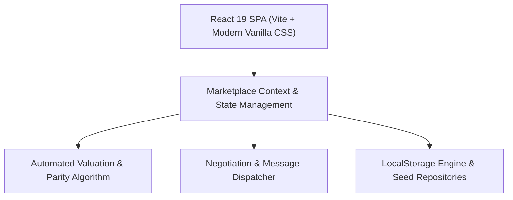

# Product Requirement Document (PRD)
## Clothing Exchange & Swap Marketplace (SwapStyle)

---

### 1. Executive Summary & Context
Fast fashion has accelerated clothing consumption, exacerbating textile landfills and global environmental strain. Millions of wearable garments in pristine condition sit unused in closets because traditional resale involves tedious pricing, seller fees, and monetary negotiations. 

**SwapStyle** is a dedicated peer-to-peer barter marketplace enabling users to exchange clothing directly without currency. The platform introduces **algorithmic value calculation**, **location-based proximity matching**, and **in-app negotiation chat**, turning circular fashion into a friction-free, rewarding community habit.

---

### 2. Objectives & Success Metrics
#### Primary Objectives:
- Provide a dedicated barter platform for 1-to-1 clothing exchange with zero monetary transactions.
- Implement automated value calculation based on garment category, brand tier, condition factor, and retail price depreciation.
- Enable local and remote swaps via geolocation filtering and courier preferences.
- Facilitate negotiation chat rooms for members to discuss sizing, condition, and handover logistics.

#### Key Performance Indicators (KPIs):
- **Textile Waste Diverted:** Total estimated kg of garments kept out of landfills.
- **Completed Swap Count:** Cumulative successful swaps executed.
- **Conversion Rate:** Ratio of initiated swap proposals to finalized trades.
- **Fairness Parity:** Average difference in estimated value between exchanged items (target within ±25%).

---

### 3. Architecture & Tech Stack

- **Frontend:** React 19, Vite, Modern Vanilla CSS Design System (Eco-luxury dark palette with `#10b981` emerald accents and glassmorphism).
- **Icons & Visuals:** `lucide-react`, `canvas-confetti`.
- **State & Data Store:** React Context API + LocalStorage persistence.
- **Valuation Module:** Algorithmic brand tiering (`luxury`, `heritage`, `premiumMinimal`, `highStreet`), category base pricing, and wear condition multipliers.

---

### 4. Site Architecture & Implemented Modules

The application comprises 7 interconnected modules and pages:

| Page / Component | Key Capabilities |
| :--- | :--- |
| **1. Explore Wardrobes (`ListingsPage`)** | Multidimensional filtering (category, brand, condition), distance radius slider (2–30 km), keyword search, sort by value/distance, and instant swap proposal CTA. |
| **2. Garment Detail (`ItemDetailPage`)** | Full gallery viewer, garment specification matrix, eco-metric badge (CO₂ saved & water spared), owner wishlist, and suggested fair-parity matches. |
| **3. Value Calculator (`CalculatorPage`)** | Dual-item side-by-side valuation simulator with real-time fair trade parity analysis (within ±25% threshold). |
| **4. Negotiation & Chat (`ChatNegotiationPage`)** | Real-time negotiation room for every active swap. Supports proposal acceptance, declining, chat messaging, and final handoff confirmation. |
| **5. User Dashboard (`UserDashboardPage`)** | Personal listed wardrobe inventory, incoming proposal approval queue, outgoing request tracker, eco score badges, and trade history archive. |
| **6. Admin Control Console (`AdminPanelPage`)** | Platform KPI metrics (CO₂ diverted, active listings, total swaps), listings moderation table with deletion powers, user audit logs, and dispute tracking. |
| **7. Garment Uploader & Swap Modal** | Interactive modals with automated value preview, preset images, handover methods (NYC Meetup vs Courier), and instant barter proposal generation. |

---

### 5. Algorithmic Valuation Formula

$$\text{Estimated Barter Value} = \max\left(15, \left[\text{Base}_{\text{Category}} \times \text{Multiplier}_{\text{Brand}} \times \text{Multiplier}_{\text{Condition}}\right]\right)$$

If original retail is provided:
$$\text{Adjusted Value} = 0.40 \times \text{Formula Value} + 0.60 \times (\text{Retail} \times 0.42 \times \text{Multiplier}_{\text{Condition}})$$

#### Brand Multipliers:
- **Luxury Tier (1.6x):** Reformation, Sézane, Acne Studios, Ganni
- **Heritage & Outdoor (1.3x):** Patagonia, Carhartt, Dr. Martens, Levi's
- **Premium Minimal (1.15x):** COS, Everlane, Arket, Massimo Dutti
- **High Street & Vintage (0.9x):** Zara, Uniqlo, Mango, Vintage / Unbranded

---

### 6. Demo Test Personas & Switching

The application comes pre-loaded with realistic users and listings that can be switched anytime from the top-right profile selector:
1. **yesudasu (Brooklyn, NY)**: Vintage denim & sustainable knits enthusiast (Eco score: 480 kg CO₂ saved).
2. **mahalaksmi (Manhattan, NY)**: Streetwear collector & outerwear specialist (Eco score: 320 kg CO₂ saved).
3. **surya (Queens, NY)**: Capsule wardrobe lover & tailored dress owner (Eco score: 210 kg CO₂ saved).
4. **pralash Chen (Admin Mode)**: Platform moderator with audit and removal capabilities.
